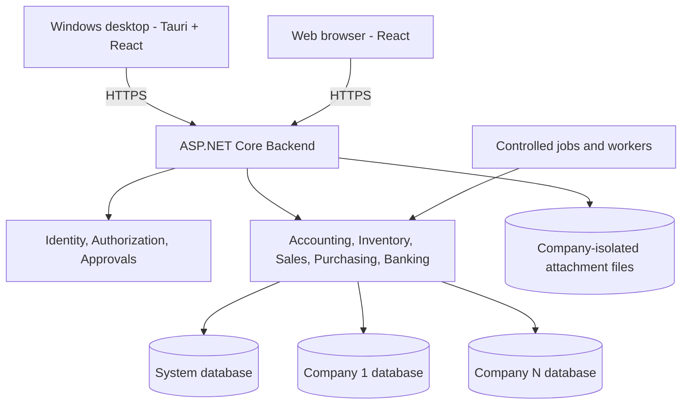
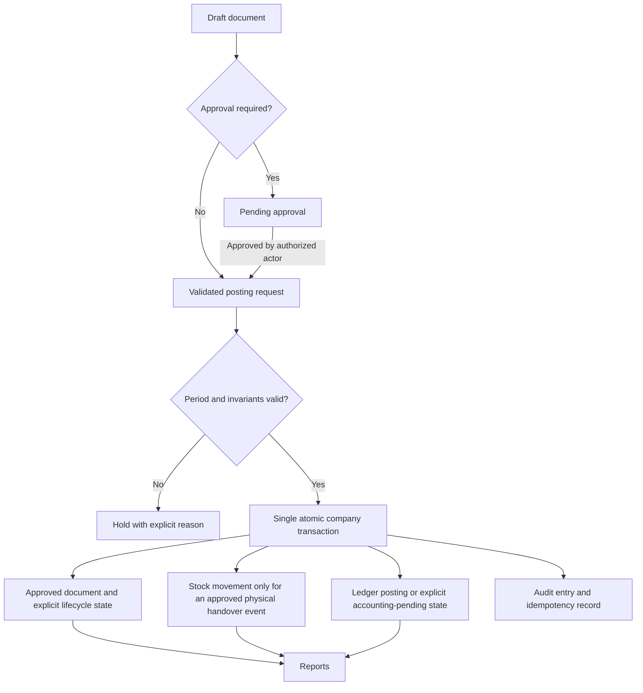

# HASM — Architecture Baseline

> **الحالة:** Draft 0.2 — 2026-11-08. تدقيق اتساق للمراجعة فقط؛ لا يجيز بدء التطوير.
> **المرجع الوظيفي:** [`SRS.md`](./SRS.md) — القرارات والتفاصيل المعتمدة مدرجة في [`DECISIONS.md`](./DECISIONS.md).

## 1. الحدود التقنية الثابتة

| الجزء | التقنية | الحدود |
|---|---|---|
| Desktop | Tauri 2 على Windows | واجهة فقط، لا اتصال بـ DB |
| Web | React + TypeScript | مشاركة مكونات واجهة مع Desktop |
| Backend | ASP.NET Core / C# | API، تحقق، RBAC، الترحيل، التسويات، التكلفة |
| Global system store | PostgreSQL — قاعدة نظام واحدة | كتالوج الشركات والهويات والتراخيص والبيانات المشتركة |
| Accounting company store | PostgreSQL — قاعدة مستقلة لكل شركة | الأستاذ والذمم والمستودعات والمستندات والحسابات |
| Attachments | Server filesystem / SMB / NFS | حسب الشركة، لا يقرأها العميل مباشرة |
| Communication | HTTPS API | Windows/Web، قابل للاستخدام في LAN/VPN وبدون Internet |



الأسهم في المخطط **ليست** صلاحيات وصول مباشر للواجهة إلى قواعد البيانات. قاعدة البيانات مركزية بالنسبة إلى Backend فقط.

## 2. نماذج النشر المعتمدة

1. **All-in-One Windows:** واجهة Windows + Backend + PostgreSQL على جهاز واحد. حتى في هذه الحالة يستعمل Desktop الـ API.
2. **Central on-premises server:** Backend وقواعد PostgreSQL على سيرفر واحد؛ أجهزة Windows ومتصفحات LAN/VPN عملاء.
3. **Split server:** Backend وخادم PostgreSQL منفصلان مع TLS وحساب خدمة محدود الصلاحيات.

يجب أن يتعامل المثبت مع إعداد خدمة Backend وإنشاء قاعدة النظام وتوصيل/إنشاء قواعد الشركات، ومفاتيح التشفير والشهادات والتعريف بالمدير الأول. يدعم Windows Server وLinux Server لتشغيل Backend وقواعد البيانات في السيناريوهات المناسبة.

## 3. تقسيم المشاريع المقترح

```text
src/
  backend/
    Api/                  # HTTP endpoints, middleware, auth boundary
    Application/          # Use cases, approvals, workflows
    Domain/               # Accounting, Inventory, ... business invariants
    Infrastructure/       # PostgreSQL, storage, crypto, scheduling
    Workers/              # Background jobs and cleanup
  frontend/
    apps/web/
    packages/ui/          # Shared React/TypeScript components, RTL/LTR
    packages/api-client/  # Typed API client, no DB access
  desktop/
    src-tauri/            # Tauri shell and platform integration
  installer/              # Server and desktop provisioning
  tooling/                # Internal migration/build/diagnostic tooling
tests/
  unit/
  integration/
  e2e/
  performance/
  security/
  deployment/
docs/
  SRS.md
  ARCHITECTURE.md
  DECISIONS.md
```

هذا **اقتراح لتنظيم الملفات**، وليس فرضاً لاستخدام عدد محدد من `.sln` أو وحدات .NET؛ تُراجع الحدود المعمارية قبل إنشاء الكود.

## 4. حدود الوحدات Modules

| الوحدة | الدور | حدود التكامل |
|---|---|---|
| Platform & Licensing | التثبيت، التراخيص، الشركات، هوية المستخدم | System DB؛ لا تخزن أرصدة الشركات |
| Parties | سجل الجهات المشترك والمعلومات المحلية | `GlobalPartyId` مقابل `LocalPartyId` |
| General Ledger | دفتر الأستاذ، السنة، الفترة، شجرة الحسابات، الترحيل | المصدر النهائي للأرصدة المالية |
| Approval & Audit | قواعد الموافقات، التوقيع المنطقي، سجل التدقيق | مشترك عبر الوحدات، لا يمكن تجاوزه |
| Inventory & Costing | حركات المخزون، وحدات، FIFO/متوسط، تسويات | أحداث أعمال لا تعني الترحيل مرتين |
| Sales & Purchasing | المستندات والتسليم والضرائب والأسعار | يفصل دورة المستند عن حدث المخزون والدفتر |
| AR/AP & Banking | تخصيص دفعات، شيكات، تسوية بنك | التخصيص لا يكرر قبض/صرف |
| Tax & FX | تطبيق قواعد ضرائب وصرف مؤرخة | حفظ القيم المستخدمة داخل المستند |
| Reporting & Print | استعلامات مقيدة بالصلاحيات، المصممان | لا يتيح وصول SQL حر للمستخدم العادي |
| Import & Export | Staging وDry Run واعتماد الترحيل | فصل الاستيراد عن البيانات المالية حتى الاعتماد |
| Backup & Updates | نسخ واستعادة وترقيات موقعة | اختبار استعادة الشركة/النظام والمرفقات |
| Diagnostics | حالة الخدمات، التنبيهات والسجلات | تنقية الأسرار والمعلومات الحساسة |

## 5. عزل قواعد الشركات والاتساق

**المبدأ:** قاعدة نظام واحدة وقاعدة مستقلة لكل شركة؛ لا نفترض Distributed Transaction ذرّية واحدة عبر قواعد PostgreSQL المختلفة.

- كل حدث مالي مرحّل لشركة يُنفّذ محلياً في DB تلك الشركة داخل **معاملة واحدة** تشمل ما يستحق الترحيل فعلاً وتدقيقه ومنع تكراره؛ أما الأثر المحاسبي الذي يُنتظر ترحيله فيحمل حالة معلّقة صريحة ولا يُمثَّل على أنه مرحّل.
- عمليات الشركة التي تتطلب هوية طرف مشترك: قراءة/تثبيت `GlobalPartyId` قبل عملية الشركة، وتخزين معرف الطلب/سجل إرسال Outbox مع التغيير المحلي عندما يلزم؛ ثم إعادة محاولة آمنة وتسوية صريحة لأي أثر عابر للقواعد. **لا يوجد Commit ذرّي مفترض يشمل قاعدتين مختلفتين**.
- قواعد الموافقات وبيانات الشركة الحساسة داخل حدود الوصول المصرح بها؛ لا يكفي `companyId` المرسل من العميل لإجازة الوصول.
- تقارير عدة شركات تنفذ في Backend بإذن صريح مع تحويل العملات وخرائط الحسابات عند الحاجة، وليست عبر SQL cross-database join.
- تعديل المعلومات الأساسية المشتركة للجهة يتم بطلب موافقة مركزية مع تدقيق؛ معلومات حساب العميل ومورد الشركة لا تُشارك تلقائياً.

## 6. تصميم ترقيم وتسمية قواعد البيانات غير الوصفية

**متطلب صريح:** الاسم الفعلي لقاعدة البيانات وجداولها وحقولها لا يكشف معنى العمل بسهولة.

- استعمل مُعرّفات فيزيائية **ثابتة وغير وصفية** لقواعد النظام والشركات **ولجميع الجداول والحقول التجارية**، ولأسماء المفاتيح/القيود/الفهارس عند كونها كاشفة للوظيفة؛ لا تتضمن اسم الشركة أو أسماء عربية/إنجليزية لعمليات المحاسبة. `Hasm_System` اسم **منطقي** وليس شرطاً أن يطابق اسم قاعدة PostgreSQL الفعلي.
- يحتفظ Backend وأدوات الـ migration بقاموس ربط منطقي ↔ فيزيائي خاص ومحدود الوصول. لا يُعرض القاموس عبر REST أو Desktop أو ملفات العميل القابلة للقراءة. يُراعى أن بيئة نشر مملوكة للعميل لا تضمن سرية القاموس عن مسؤول السيرفر ذي الصلاحيات الكاملة.
- استعمل معرّفات منضبطة وفريدة حتمية عبر إصدارات المخطط (لا تعيد توليد الأسماء في كل نسخة).
- يجب أن تبقى قراءة الأخطاء، الاختبارات، النسخ، الاستعادة، المصممات والتقارير ممكنة عبر الطبقات المنطقية؛ لا ينبغي أن يؤدي الإخفاء إلى SQL ديناميكي غير آمن.
- لا يعامل الإخفاء وسيلة حماية أساسية: DBA ذو صلاحية كاملة يستطيع دراسة القيود والبيانات وعلاقات PostgreSQL؛ الأمان الحقيقي هو حدود الشبكة، صلاحيات أقل امتياز، Backend-only، TLS، الحماية من تسريب النسخ والأسرار والتدقيق.
- ممنوع تخزين الأسرار ومفاتيح التوقيع أو بيانات العملاء في المستودع، حتى لو كان Private.

## 7. مبدأ الترحيل المحاسبي



**سجل وثيقة الأعمال** و**التأثير على المخزون** و**التأثير المحاسبي** حالات مرتبطة، لكنها ليست الشيء نفسه. في نمط الفاتورة المباشرة تتضمن الموافقة حدث التسليم/الاستلام المادي؛ وفي النمط المنفصل يأتي الحدث من وثيقة التسليم/الاستلام المعتمدة. لا يتكرر الحدث عند اكتمال الفاتورة. كل حالة واضحة حتى عند التسليم الجزئي أو GRNI أو الترحيل المؤجل؛ لا يُكتب `Posted` على قيد لم يُرحّل فعلاً. المستند **المعتمد غير المرحّل** يعاد اعتماده عند تعديل مؤثر؛ أما `Posted` فلا يُعدّل مباشرة، بل يُصحح بسجلات عكس/تسوية. المعاملة المالية المتوازنة شرط إلزامي.

## 8. محرك التكلفة والحركات المؤرخة سابقاً

- نطاق التقييم: `Item × Warehouse × Company` لكل من FIFO والمتوسط المتحرك.
- FIFO يحتفظ بطبقات وتخصيص الكميات، والمتوسط المتحرك يحافظ على دفتر تغير الكمية والقيمة والمتوسط.
- التحويلات بين المستودعات تنقل تكلفة فعلية موثقة، ويُسجل الإدخال والاستلام بتطابق يمنع ازدواج القيمة.
- أي إدخال بتاريخ سابق يجب أن يُشغّل تحليل Impact Preview قبل الموافقة؛ يعاد حساب الحركات المتأثرة زمنياً مع تبعاتها على المستودعات المرتبطة.
- الاستهلاك والتعديل المالي يعالجان بوثائق تسوية جديدة؛ لا تحديث رجعي صامت للأستاذ المرحّل؛ `Final Closed` حاجز للترحيل.
- عمليات حساب التكلفة تعتمد قفل/تحكم تزامن مناسبين لمنع الترحيل المتضارب للصنف/المستودع؛ تفاصيل آلية القفل تُحسم في التصميم التفصيلي والاختبارات.

## 9. الأمن والتحقق والصلاحيات

- جلسات هوية مُتحقق منها عبر Backend، RBAC بنطاقات وPermissions دقيقة، SoD حيث يلزم، MFA وحسابات دعم طوارئ محمية.
- اتصالات HTTPS خارجية وTLS بين Backend وPostgreSQL؛ إعداد CORS/CSRF/cookies مناسب للويب، وعدم كشف قواعد الشركة للعامة.
- استخراج الملفات دائماً من Backend بعد إذن مالك الشركة والمستند؛ منع path traversal والتحقق من نوع الملف والحجم وإمكان فحص محتوى المرفقات.
- Encryption keys وأسرار الترخيص والنسخ تُدار عبر مخزن أسرار آمن للنشر المحلي مع قابلية استعادة مدروسة؛ لا مفاتيح داخل Git أو تطبيق Tauri.
- سجل تدقيق Append-only منطقياً، محمي بوصول ومؤشرات كشف عبث؛ الحدث المالي وتدقيقه وسجل منع تكراره يُثبَّتون في معاملة قاعدة الشركة نفسها، بينما تزامن البيانات إلى قاعدة النظام يتم بطريقة تعافٍ من الفشل لا تدعي معاملات موزعة. يُنسخ التدقيق إلى وسيط مستقل محمي عند الإمكان.
- حماية المدخلات والأوامر SQL بالمعاملات Parameters، ومراجعة أي أداة مصمم تقارير لمنع تجاوز صلاحيات DB.

## 10. واجهات الاستخدام

- Shared React components؛ RTL وLTR، واجهات قابلة للتنقل بلوحة المفاتيح.
- Hover-activated cascading menus للقوائم المكتبية، مع فتح تلقائي للقائمة الأم والفرعية عند وضع المؤشر؛ **تنفيذ الأمر النهائي بنقرة أو Enter فقط**.
- منطقة انتقال آمنة وتأخير قصير ضد إغلاق القائمة عند انتقال المؤشر، Flip للمساحة المتاحة، ARIA roles، دعم touch/click.
- المرفقات والتقارير وعمليات الموافقة تُعرض ضمن نطاق الشركة والفرع والحقوق، لا في صفحات عامة.
- الشعار والألوان الأصلية المعتمدة من صاحب المشروع تُستخدم من الأصل الرسمي، لا يعاد توليدها.

## 11. جلسات العمل والعمل دون إنترنت

- الجلسات المرخّصة بالتزامن تحسب لكل Session نشطة حتى لو تعود لنفس المستخدم على Web وDesktop؛ Heartbeat وآلية تحرير Timeout مضبوطة.
- عند انقطاع اتصال شبكة الشركة يمكن لعميل الجهاز حفظ **مسودات محلية آمنة**؛ يعاد التحقق والاعتماد والترحيل في السيرفر بعد الاتصال.
- لا كتابة مخزون أو قيود مالية دون اتصال، ولا Multi-master replication بين قواعد محلية في الإصدار الأول.

## 12. النسخ الاحتياطي والترقيات والتعافي

- ملف قاعدة بيانات الشركة وملفات المرفقات يجب أن يؤخذا ويستعادا تحت نقطة اتساق قابلة للشرح والاختبار.
- استعادة شركة واحدة لا ترجع `Hasm_System` أو بقية الشركات للوراء؛ فحص نسخة المخطط ومراجع Parties وتوافق الترخيص ثم استعادة في بيئة مؤقتة قبل Cutover.
- النسخ الموقعة/المشفرة والتحديث اليدوي عبر حزم موقعة، Preflight للهجرات وحالة النظام ثم Health Check بعد الترقية.
- RPO/RTO تُضبط بحسب خطط النسخ ويتم التحقق منها عملياً؛ أرقام تجريبية غير مختبرة لا تتحول إلى ضمان.

## 13. معيار الأداء

بيئة اختبار مرجعية: 8 vCPU، 32 GB RAM، 500 GB SSD، 5 شركات، 50 جلسة متزامنة، 20k أصناف، 10k أطراف، 100k فواتير، 500k قيود/حركات، 60 دقيقة. أهداف P95 في SRS، مع قياس موارد النظام ووقت DB والخلل تحت التزامن. لا تعتبر مواصفات بيئة الاختبار حدّاً أدنى للإنتاج.

## 14. سياسة التطوير على GitHub

- `main`: النسخة المعتمدة فقط؛ فروع `docs/*` للتوثيق و`feature/*` للتطوير و`fix/*` للتصحيحات.
- Pull Request لكل تغيّر، مع وصف/اختبارات/تأثير بيانات/خطة عكس عندما يلزم.
- CI/CD للمراجعة والبناء والاختبار والفحص الأمني، وعدم ربط النجاح بوجود حماية GitHub مدفوعة غير متاحة للمستودع.
- `.gitignore` ضروري لكنه لا يحمي الأسرار التي دخلت التاريخ سابقاً؛ يلزم تفتيش تغييرات الملفات قبل Commit/Push.
- `CLAUDE.md` تعليمات مساهمة للوكيل، ولا يتجاوز SRS ولا يعطي إذناً للبرمجة قبل اعتماد المستند.

## 15. القرارات المعمارية التي لا تحتاج إلى أسئلة إضافية حالياً

الاختيارات التنفيذية مثل أسماء المشاريع الدقيقة، إطار ORM، آلية رسائل داخلية، طريقة تقديم الملفات وتجميع الـ UI، TTL الجلسات، سعة مرفقات Trial، ومواعيد RPO/RTO الافتراضية تُوثق في التصميم التفصيلي وتُختبر دون توسيع نطاق المنتج أو إعادة فتح القرارات المحاسبية.

**Gate:** اقرار صاحب المشروع لوثائق SRS/Architecture/Decisions أولاً، ثم تقسيم المتطلبات إلى مراحل تنفيذية واختبارات وقبول قبل كتابة الكود.
